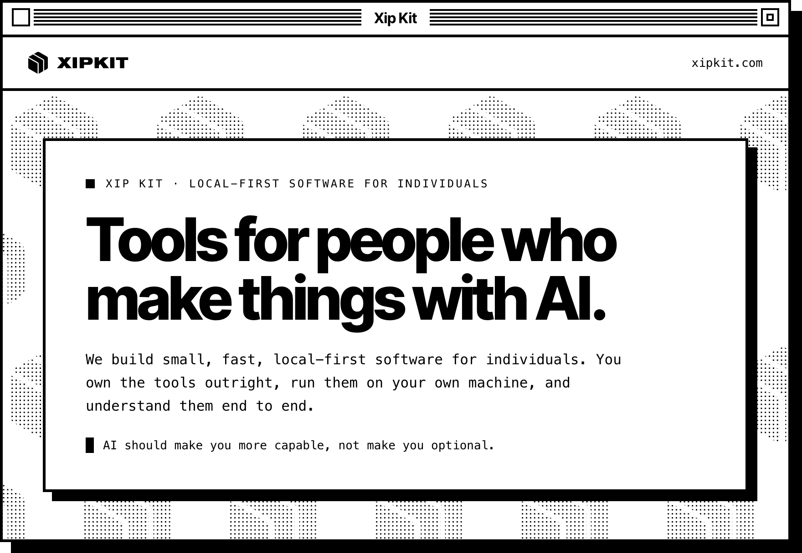
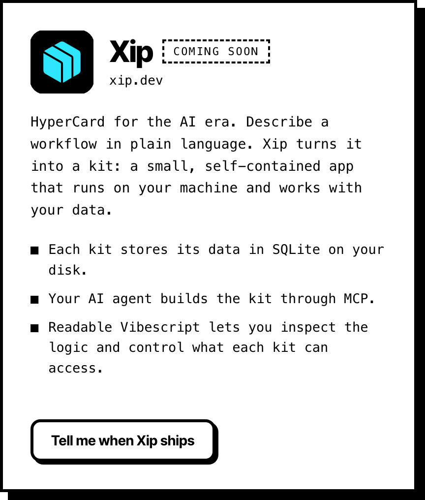
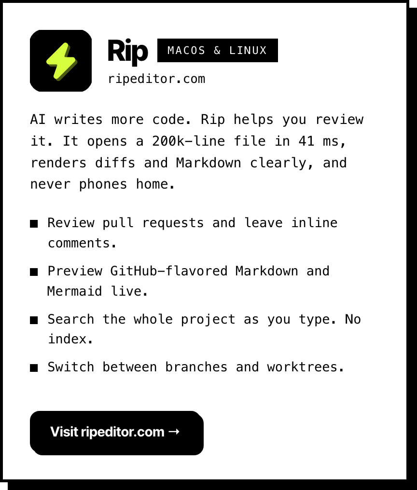
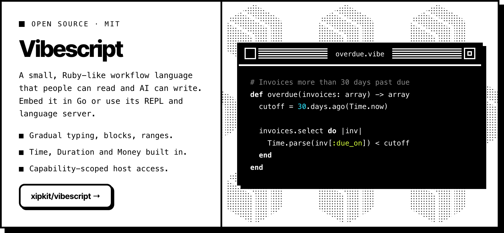
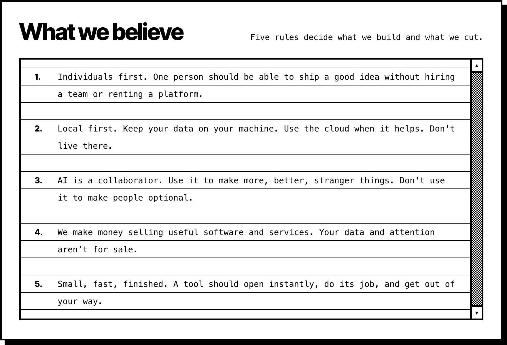

<a href="https://xipkit.com"><picture><source media="(prefers-color-scheme: dark)" srcset="assets/hero-dark.png"></picture></a>

<a href="https://xipkit.com/#notify"><picture><source media="(prefers-color-scheme: dark)" srcset="assets/xip-dark.png"></picture></a><a href="https://ripeditor.com"><picture><source media="(prefers-color-scheme: dark)" srcset="assets/rip-dark.png"></picture></a>

<a href="https://github.com/xipkit/vibescript"><picture><source media="(prefers-color-scheme: dark)" srcset="assets/oss-dark.png"></picture></a>

<picture><source media="(prefers-color-scheme: dark)" srcset="assets/believe-dark.png"></picture>

  <a href="https://xipkit.com/#notify"><b>Hear from us when something ships →</b></a>

  <a href="https://xipkit.com">xipkit.com</a> ·
  <a href="https://ripeditor.com">ripeditor.com</a> ·
  <a href="https://vibescript-lang.org">vibescript-lang.org</a> ·
  <a href="https://x.com/xipkit">@xipkit</a> ·
  <a href="https://youtube.com/@xipkit">YouTube</a> ·
  <a href="mailto:hi@xipkit.com">hi@xipkit.com</a>

